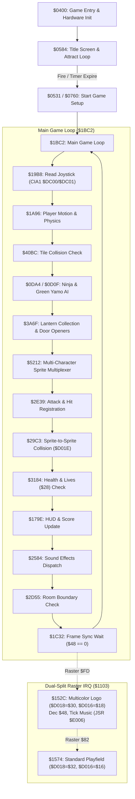

# Bruce Lee (Commodore 64) - Reverse Engineering & Disassembly

A comprehensive reverse engineering and source reconstruction project for the classic Commodore 64 game **Bruce Lee** (1984 Datasoft, Inc.), originally programmed by **Ron J. Fortier** with music by **John A. Fitzpatrick**.

This repository contains the full investigative toolchain, memory dumps, documentation, clean standalone binaries, and reconstructed modular 6502 assembly source code.

---

## Table of Contents

- [Project Highlights](#project-highlights)
- [Repository Structure](#repository-structure)
- [How to Play the Clean Game](#how-to-play-the-clean-game)
- [Reverse Engineering Summary](#reverse-engineering-summary)
  - [1. Decompression & Cracker Pipeline](#1-decompression--cracker-pipeline)
  - [2. Clean Standalone Release](#2-clean-standalone-release)
  - [3. Engine Subsystems Architecture](#3-engine-subsystems-architecture)
- [Reconstructed Source Code (`src/`)](#reconstructed-source-code-src)
- [Toolchain (`tools/`)](#toolchain-tools)
- [Memory Map Overview](#memory-map-overview)
- [Credits & License](#credits--license)

---

## Project Highlights

- **100% Decompression & Unpacking Reversal**: Unraveled the multi-stage cracker protection from the original `"bruce lee+2 /rem"` release (REMEMBER cracktro, Reyn Ouwehand SID intro music, doc reader scroller, and trainer selectors).
- **Clean Standalone Binaries**: Generated `brucelee_clean.prg` and `brucelee_clean.d64` which boot directly into the authentic Datasoft title screen without cracker intros or trainer menus.
- **Pristine Memory Capture**: Extracted raw 64KB RAM dumps at the exact entry point (`$0400`) and title screen (`$070B`).
- **Complete Subsystem Reverse Engineering**:
  - Main game loop at `$1BC2` with all sub-routines mapped (input, physics, AI, combat, tile rendering, animation).
  - Dual-split raster interrupt architecture (`$1103`, `$152C`, `$1574`) implementing mid-screen multicolor/text splits.
  - John A. Fitzpatrick's *Micropearl Music Player* running in RAM under KERNAL at `$E000-$F1FF`.
  - 20-room world layout, RLE tile decompressor, and per-room event handlers using the RTS jump trick.
  - Hardware sprite collision registers (`$D01E`) and combat hit registration.
- **Reconstructed Assembly Source**: Disassembled and labeled into structured modules under `src/` with standard C64 hardware equates and zero-page memory maps.

---

## Repository Structure

```text
bruce_lee/
├── README.md                           # This document
├── brucelee_clean.d64                  # Clean, cracktro-free 35-track C64 disk image
├── brucelee_clean.prg                  # Standalone self-decrunching single-file PRG
├── Bruce Lee.d64                       # Original source disk image (cracked release)
├── brucelee.prg                        # Extracted cracked PRG
│
├── src/                                # Reconstructed 6502 assembly source modules
│   ├── brucelee.asm                    # Master assembly file linking all modules
│   ├── c64.inc                         # C64 hardware register equates (VIC, SID, CIA, Color RAM)
│   ├── zeropage.inc                    # Zero-page variable mappings ($0000-$00FF)
│   ├── main.asm                        # Entry ($0400), startup, font extraction & main loop ($1BC2)
│   ├── title.asm                       # Title screen setup ($0584), attract loop & player options
│   ├── irq.asm                         # IRQ dispatcher ($1103) & dual-split raster routines
│   ├── player.asm                      # Joystick input ($19B8) & character physics ($1A96)
│   ├── enemies.asm                     # Ninja AI ($0DA4), Green Yamo AI ($0D0F), hazard update
│   ├── combat.asm                      # Sprite collision ($29C3), hit detection ($2E39), player death
│   ├── rooms.asm                       # Room transition ($2FA0), tile renderer ($09BC), room tables
│   ├── sprites.asm                     # Sprite multiplexer ($5212) & shape blitter ($26A0)
│   ├── strings.asm                     # Screen text printing ($17E2) & string table ($43BE)
│   └── sound.asm                       # Micropearl music player interface under KERNAL ($E000-$F1FF)
│
├── notes/
│   └── reverse-engineering.md          # Comprehensive technical documentation & findings
│
├── tools/                              # Analysis, disassembly, rendering & build toolchain
│   ├── disasm6502.py                   # 6502 disassembler with symbolic operand decoding
│   ├── generate_asm.py                 # Assembly source module generator
│   ├── prg_tool.py                     # PRG parser, hex dumper & PETSCII string scanner
│   ├── render_screen.py                # Direct character & color RAM PNG renderer
│   ├── build_clean_game.py             # Memory segment extractor & clean PRG builder
│   ├── analyze_rooms.py                # Room layout & attribute table inspector
│   ├── dump_room_table.py              # Master room pointer table decoder
│   ├── inspect_layout_pointers.py      # Room tile stream pointer decoder
│   ├── find_sound_calls.py             # Audio driver invocation scanner
│   └── exomizer                        # Compiled Exomizer cruncher binary
│
└── dumps/                              # Memory snapshots, segments & rendered screenshots
    ├── ram_game_start_0400.bin         # Pristine 64KB RAM dump at game start ($0400)
    ├── ram_game_title.bin              # 64KB RAM dump at title screen loop ($070B)
    ├── brucelee_main_0400_c6ff.bin     # Main game body ($0400-$C6FF)
    ├── brucelee_under_kernal_e000_f1ff.bin # Audio driver & tables under KERNAL ($E000-$F1FF)
    ├── brucelee_vectors_fffa_ffff.bin  # Hardware interrupt vectors ($FFFA-$FFFF)
    └── rendered_title.png              # Pixel-perfect 320x200 render of authentic title screen
```

---

## How to Play the Clean Game

The clean versions can be played on real Commodore 64 hardware or in any C64 emulator such as **VICE**:

### Running with VICE (`x64sc`)

Launch the disk image:
```bash
x64sc brucelee_clean.d64
```

Or launch the single-file PRG:
```bash
x64sc brucelee_clean.prg
```

### Controls

- **Player 1**: Joystick Port 2 (VICE default: NumPad `8/4/6/2` for directions, `0` / `Right Ctrl` for Fire).
- **Player 2**: Joystick Port 1 (used in 2-Player mode or when Player 2 controls the Green Yamo).
- **Title Screen Options**:
  - Press `1` or `2` to toggle 1 Player / 2 Players.
  - Press `C` to toggle Computer vs. Player control of the Green Yamo.
  - Press **Fire** or **Space** to begin the game immediately.

---

## Reverse Engineering Summary

### 1. Decompression & Cracker Pipeline

The source disk image `"bruce lee+2 /rem"` contained several layers of compression and cracker machinery:

1. **Stage 1 (`$080B`)**: Outer bootstrap copying backward decruncher to zero page/stack (`$00F0-$01EF`), decompressing into `$0800-$CF78` and jumping to `$2800`.
2. **Stage 2 (`$2800`)**: REMEMBER cracktro with Reyn Ouwehand SID music (`$1006`), raster bars, and doc reader (`$3000-$5EE0`).
3. **Stage 3 (`$0340`)**: Tape buffer relocator running in All-RAM mode (`$01 = $34`), shifting 41,472 bytes from `$5EE0-$FFFF` down to `$0801-$AA00`.
4. **Stage 4 (`$080B`)**: Relocated Stage 2 decruncher expanding backward into `$0800-$B472` and jumping to `$0802`.
5. **Stage 5 (`$0802`)**: Zero-page backward memory shifter (`$0035`) moving memory to `$5300-$FF00`, followed by an RLE expander (`$0002`) jumping to `$C500`.
6. **Stage 6 (`$C500`)**: Cracker title bitmap, trainer options (`$C633`), clearing zero page, restoring `$C000-$C4FF` down to `$0400-$08FF`, and jumping to `$0400`.
7. **Stage 7 (`$0400`)**: Authentic game entry point.

### 2. Clean Standalone Release

To produce a clean release free of cracktro and trainer code:
- Extracted raw pristine memory segments from `ram_game_start_0400.bin`:
  - Main code: `$0400-$C6FF` (49,920 bytes)
  - Under-KERNAL RAM: `$E000-$F1FF` (4,608 bytes)
  - Vectors: `$FFFA-$FFFF` (6 bytes)
- Created a startup trampoline at `$0200` to set processor port `$01 = $36`, clear scratch RAM `$0334-$03FF`, and jump to `$0400`.
- Compressed using Exomizer with All-RAM decrunching (`-Di_ram_during=0x34 -Di_ram_exit=0x36`).

### 3. Engine Subsystems Architecture



- **Dual-Split Raster IRQ**: Top split at raster line `$FD` enables multicolor mode (`$D018 = $30`, `$D016 = $18`) for the Bruce Lee logo and calls music frame tick `JSR $E006`. Bottom split at raster line `$82` reverts to standard text mode (`$D018 = $32`, `$D016 = $16`).
- **RAM Under KERNAL**: KERNAL ROM is banked out during gameplay (`$01 = $35`), allowing code to call the *Micropearl Music Player* at `$E000` (Init), `$E003` (Play SFX), and `$E006` (Frame Update).
- **World System**: 20 interconnected rooms (indexed by `$29`). RLE tile streams at `$4B34/$4B49` unpack to screen memory `$8C78`. Per-room event routines at `$4EC4` are called via the stack RTS jump trick (`$3A6F`).
- **Collision & Combat**: Hardware sprite-to-sprite collision (`$D01E`) checked at `$29CE`. Collision flags for Bruce (`$B3`), Ninja (`$B4`), and Green Yamo (`$B5`) trigger hit reactions and damage.

---

## Reconstructed Source Code (`src/`)

The source files in [`src/`](file:///home/kelsjon3/Downloads/C64/ROMS/bruce_lee/src) represent the reconstructed 6502 assembly codebase:

| Source File | Description |
|---|---|
| [`src/c64.inc`](file:///home/kelsjon3/Downloads/C64/ROMS/bruce_lee/src/c64.inc) | Hardware registers (VIC-II, SID, CIA1, CIA2, Color RAM) |
| [`src/zeropage.inc`](file:///home/kelsjon3/Downloads/C64/ROMS/bruce_lee/src/zeropage.inc) | Reverse-engineered zero page variables & character tables |
| [`src/main.asm`](file:///home/kelsjon3/Downloads/C64/ROMS/bruce_lee/src/main.asm) | Entry point (`$0400`), initialization, and main game loop (`$1BC2-$1C36`) |
| [`src/title.asm`](file:///home/kelsjon3/Downloads/C64/ROMS/bruce_lee/src/title.asm) | Title screen setup (`$0584`), attract mode & option selectors |
| [`src/irq.asm`](file:///home/kelsjon3/Downloads/C64/ROMS/bruce_lee/src/irq.asm) | Raster IRQ dispatcher (`$1103`) & dual-split handlers (`$152C`, `$1574`) |
| [`src/player.asm`](file:///home/kelsjon3/Downloads/C64/ROMS/bruce_lee/src/player.asm) | Joystick input reader (`$19B8`) & player physics (`$1A96`) |
| [`src/enemies.asm`](file:///home/kelsjon3/Downloads/C64/ROMS/bruce_lee/src/enemies.asm) | Ninja AI (`$0DA4`), Green Yamo AI (`$0D0F`), hazards (`$0DB1`) |
| [`src/combat.asm`](file:///home/kelsjon3/Downloads/C64/ROMS/bruce_lee/src/combat.asm) | Sprite collision (`$29C3`), hit registration (`$2E39`), lives & death |
| [`src/rooms.asm`](file:///home/kelsjon3/Downloads/C64/ROMS/bruce_lee/src/rooms.asm) | Room transition (`$2FA0`), screen tile renderer (`$09BC`), room tables |
| [`src/sprites.asm`](file:///home/kelsjon3/Downloads/C64/ROMS/bruce_lee/src/sprites.asm) | Sprite multiplexer (`$5212`) & dynamic shape blitter (`$26A0`) |
| [`src/strings.asm`](file:///home/kelsjon3/Downloads/C64/ROMS/bruce_lee/src/strings.asm) | Screen string printer (`$17E2`) & string table |
| [`src/sound.asm`](file:///home/kelsjon3/Downloads/C64/ROMS/bruce_lee/src/sound.asm) | Micropearl music player interface (`$E000-$F1FF`) under KERNAL |
| [`src/brucelee.asm`](file:///home/kelsjon3/Downloads/C64/ROMS/bruce_lee/src/brucelee.asm) | Master assembly file linking all modules |

---

## Toolchain (`tools/`)

All custom Python tools created during this project are located in [`tools/`](file:///home/kelsjon3/Downloads/C64/ROMS/bruce_lee/tools):

- `disasm6502.py`: Accurate 6502 disassembler supporting C64 hardware annotations and raw instruction tuple generation.
- `generate_asm.py`: Modular assembly source builder generating labeled source files from binary memory snapshots.
- `prg_tool.py`: PRG layout parser, PETSCII/ASCII string extractor, and hex dumper.
- `render_screen.py`: Direct C64 character and color RAM renderer outputting 320x200 PNG images.
- `analyze_rooms.py`: Inspects room pointer tables, background colors, and enemy spawn coordinates.
- `build_clean_game.py`: Automates extraction of clean RAM chunks and builds `brucelee_clean.prg`.

---

## Memory Map Overview

| Range | Size | Description / Contents |
|---|---|---|
| `$0000-$00FF` | 256 B | Zero page workspace (player lives `$28`, room `$29`, frame delay `$48`) |
| `$0100-$01FF` | 256 B | 6502 Hardware stack |
| `$0200-$02FF` | 256 B | Hardware RNG seed buffer sampled from SID noise (`$D41B`) |
| `$0300-$03FF` | 256 B | System vectors and scratch workspace |
| `$0400-$08FF` | 1,280 B | Game entry, initialization, font generation, startup |
| `$0900-$33FF` | 10.75 KB | Main game loop, player movement, physics, combat, collision |
| `$3400-$37FF` | 1 KB | Text strings: `"BRUCE LEE"`, `"DATASOFT PRESENTS"`, player options |
| `$3800-$4EFF` | 5.75 KB | Screen layout data, collision tables, level maps, event tables |
| `$5000-$57FF` | 2 KB | Game routines & animation data |
| `$5900-$81FF` | 10.25 KB | Sprite shape data (Bruce Lee, Ninja, Green Yamo, items, hazards) |
| `$8400-$87FF` | 1 KB | Level attribute / tile data |
| `$8800-$8BFF` | 1 KB | Character generator font (populated from CHARGEN ROM) |
| `$9000-$A5FF` | 5.5 KB | Music data and audio sequences |
| `$A600-$B3FF` | 3.5 KB | Micropearl Music Player (c) 1983 John A. Fitzpatrick |
| `$B400-$C6FF` | 4.75 KB | High score tables, screen buffers, loader staging |
| `$E000-$F1FF` | 4.5 KB | Under-KERNAL RAM routines (`JMP $E300`, `$E306`, `$E49E`, level data) |
| `$FFFA-$FFFF` | 6 B | Hardware RAM interrupt vectors (`NMI=$1116, RESET=$1116, IRQ=$1103`) |

---

## Credits & License

- Original Game: (c) 1984 Datasoft, Inc.
- Original Game Design & Programming: **Ron J. Fortier**
- Graphics: **Kelly Day**
- Micropearl Music Player & Audio: **John A. Fitzpatrick**
- Reverse Engineering & Reconstructed Source: 2026 kelsjon3